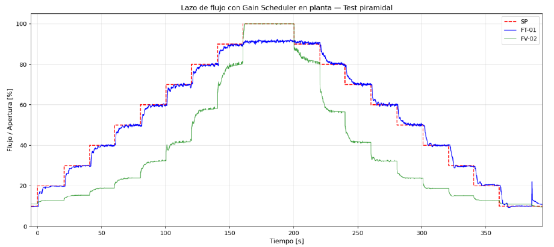
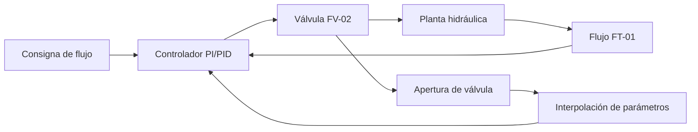
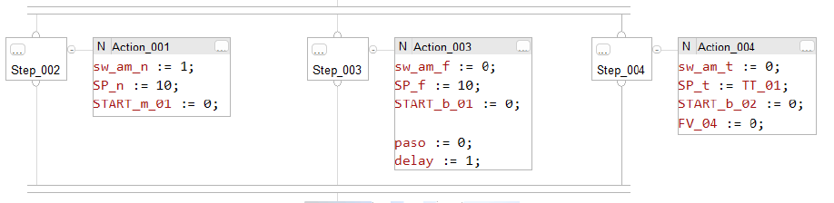

# Control por programación de ganancias en una planta de estanque

**Gain scheduling · PLC ControlLogix · MATLAB/Simulink · Validación experimental · Control batch**

Control del flujo de descarga de una planta hidráulica mediante parámetros que cambian con la apertura de la válvula. El proyecto aborda la no linealidad del proceso y documenta su evolución hacia una secuencia batch con nivel, flujo y temperatura.

**[Leer informe de gain scheduling](docs/informe-gain-scheduling.pdf) · [Descargar informe](docs/informe-gain-scheduling.pdf?raw=true) · [Descargar preinforme batch](docs/preinforme-control-batch.pdf?raw=true)**

*Figura 17 del documento de laboratorio 3, página 29. La consigna SP se compara con el flujo FT-01 y la apertura FV-02. La zona superior de la prueba permite observar el límite físico de caudal.*

## Problema de ingeniería

La relación entre apertura de válvula y flujo cambia a lo largo del rango de trabajo. Por ello, un controlador ajustado para una zona puede resultar lento o demasiado agresivo en otra. El proyecto parte de los modelos y ensayos del [trabajo de control PID](https://github.com/TheNicolen/Controlador-PID-de-Nivel-y-flujo-en-planta-de-un-estanque) y reemplaza la sintonía única por una programación de ganancias.

La estrategia implementada selecciona e interpola parámetros previamente ajustados. Se trata de **gain scheduling**; no se documenta un estimador que identifique la planta en línea ni una ley de adaptación autónoma de parámetros.

## Diseño del controlador

Se utiliza la apertura de **FV-02** como variable programadora. El documento describe cuatro regiones iniciales: 0–20 %, 20–40 %, 40–70 % y 70–100 %. Dentro del diseño se evita depender únicamente de cambios abruptos de consigna y se busca reducir la sensibilidad al ruido del sensor de flujo.

La interpolación entre nodos permite modificar gradualmente la ganancia proporcional y el tiempo integral al recorrer el rango de operación. La lógica se integra en el PLC mediante Ladder y texto estructurado, y se verifica previamente en MATLAB y RSLogix Emulate.

*Esquema explicativo de la estrategia descrita en el informe.*

## Validación y resultados

La prueba aplica escalones de 10 % en una secuencia piramidal ascendente y descendente. Así se recorren las regiones en ambos sentidos y se observa el efecto de la histéresis de la válvula. El documento reporta exportación de datos del historiador de FactoryTalk hacia MATLAB.

En simulación se describe un asentamiento cercano a **3 s**, con transiciones suaves. En el análisis experimental se reporta seguimiento del orden de **1–2 s por escalón** en buena parte de la prueba. Son observaciones del documento, sin una tabla homogénea de métricas para cada transición; no se interpretan como una comparación temporal exacta entre ambos entornos.

El resultado más visible aparece con la consigna de 100 %: el flujo medido se mantiene cerca de **93 %**, aun con la válvula completamente abierta. El informe atribuye esa diferencia al máximo caudal disponible del conjunto válvula-bomba, una restricción ausente del modelo de simulación.

### Ajuste de parámetros en planta

La tabla 3 de la página 29 presenta cinco nodos finales, distintos de la división introductoria en cuatro zonas. Se conserva esa distinción para no confundir regiones de operación con nodos de interpolación.

| Nodo reportado | Kc simulación | Kc planta | Ti simulación | Ti planta |
|---|---:|---:|---:|---:|
| Z1 | 0,09 | 0,03 | 0,19 | 0,72 |
| Z2 | 0,11 | 0,07 | 0,20 | 0,79 |
| Z3 | 0,31 | 0,27 | 0,24 | 0,85 |
| Z4 | 0,36 | 0,51 | 0,26 | 1,16 |
| Z5 | 0,38 | 1,18 | 0,27 | 1,27 |

Las cifras son las publicadas en el documento. La tabla fuente no explicita la unidad de `Ti`; no se asigna una unidad ni se presentan estos valores como configuración lista para cargar en otro PLC. La diferencia entre simulación y planta ilustra la necesidad de reajuste experimental.

## Extensión: control batch con temperatura

El laboratorio 4 amplía el sistema con una secuencia de **16 pasos**, **cinco rampas** y pausas entre etapas. Integra el lazo térmico con intercambiadores de calor, recirculación, agua caliente y enfriamiento.

*Figura 23 del preinforme 4, página 25. Organización de las acciones en ramas paralelas para coordinar los lazos.*

La lógica se estructura mediante SFC y acciones en texto estructurado, con tiempo de escaneo de **100 ms**. La validación descrita utiliza Simulink y extiende el modelo de flujo y nivel con un lazo térmico de dinámica más lenta.

**Estado documentado:** diseño y simulación, con pruebas finales en planta planteadas como trabajo posterior. El preinforme no acredita que se haya completado la validación física final del batch. La simulación térmica descrita tarda aproximadamente diez minutos en alcanzar la consigna y el batch completo tiene una duración indicada de 41 minutos.

## Aprendizajes y límites

- Un modelo por zonas mejora la representación del proceso, pero requiere ajustar también el controlador.
- La interpolación facilita transiciones graduales entre sintonías.
- La simulación orienta el ajuste inicial; las ganancias finales dependen del comportamiento físico real.
- El límite de caudal no se elimina aumentando las ganancias.
- La coordinación batch añade secuencias, rampas y tiempos de espera al problema de regulación.

El documento del laboratorio 3 conserva «Pre informe» en su nombre original, aunque incluye resultados en planta y conclusiones. Se publica íntegro. Las curvas y cifras se presentan como evidencia reportada por el equipo; no se recalcularon sin los datos originales.

## Equipo y documentación

**Grupo 10:** Joaquín Cuevas Rodríguez, Nicolás Salas Reyes y Vicente San Martin Pinela. Laboratorio de Sistemas de Control, Universidad de Concepción, 2026-1. Docente indicado: Juan Pablo Segovia Vera.

Los informes no separan las responsabilidades individuales; se conserva la autoría conjunta.

| Archivo | Contenido |
|---|---|
| [Informe de gain scheduling, 31 páginas](docs/informe-gain-scheduling.pdf) | Diseño, simulación, prueba en planta y comparación de parámetros |
| [Preinforme batch, 37 páginas](docs/preinforme-control-batch.pdf) | Secuencias, rampas, lazo térmico y validación simulada |
| `assets/` | Figuras originales extraídas de los informes |
| `docs/SHA256SUMS.txt` | Huellas de integridad de ambos PDF originales |

Esta publicación contiene documentación. Los programas de PLC, modelos Simulink y datos del historiador aún no están incluidos. Las referencias y créditos de figuras se conservan en los PDF originales.

## Otros proyectos

[Modelación y control PID](https://github.com/TheNicolen/Controlador-PID-de-Nivel-y-flujo-en-planta-de-un-estanque) · [Procesador RISC-V](https://github.com/TheNicolen/Dise-o-de-procesador-RISCV-multiciclo) · [Procesamiento de imágenes en FPGA](https://github.com/TheNicolen/SuperResolucionMedianteInterpolacionBicubicayVecinomasCercanoenunaRegionArbitraria)
